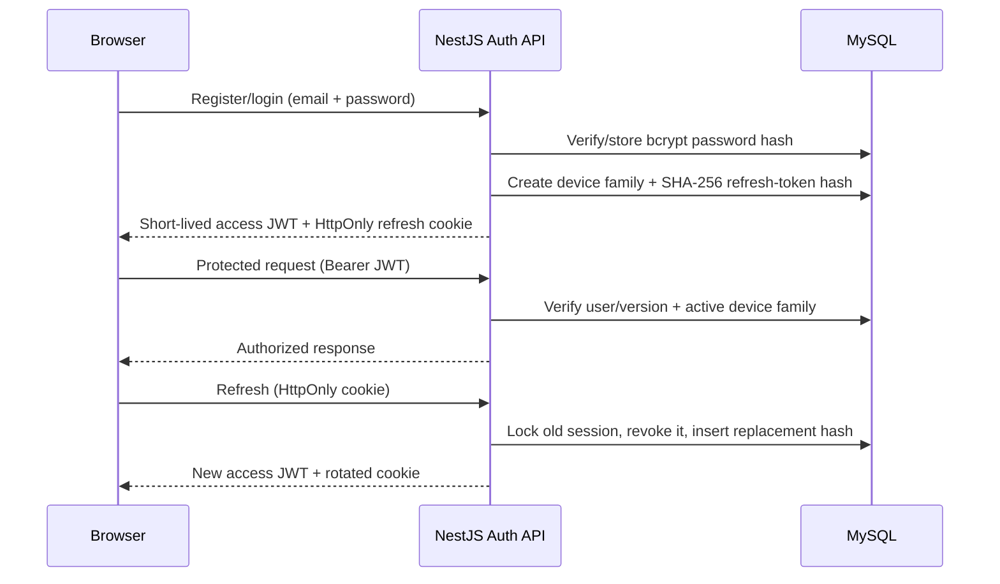
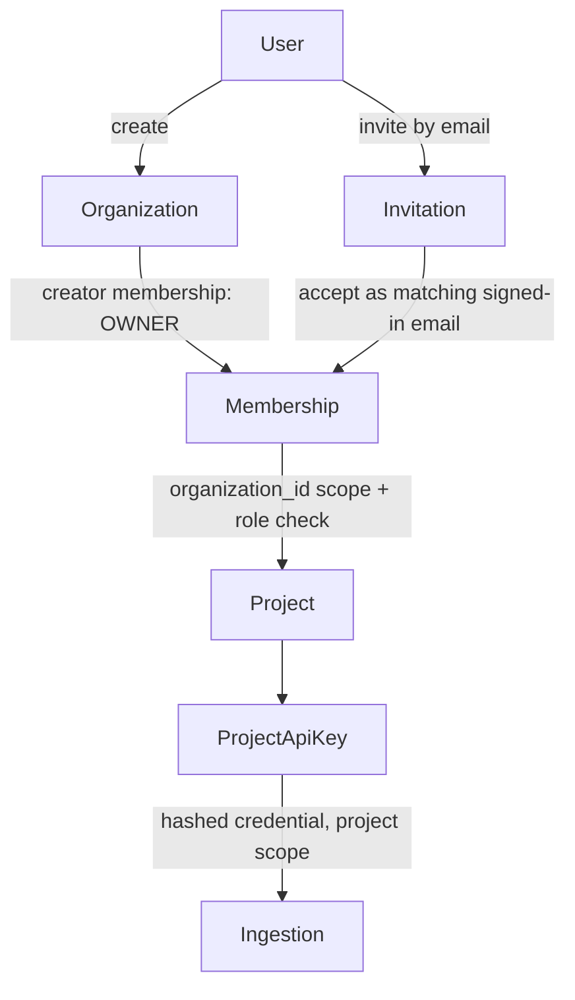
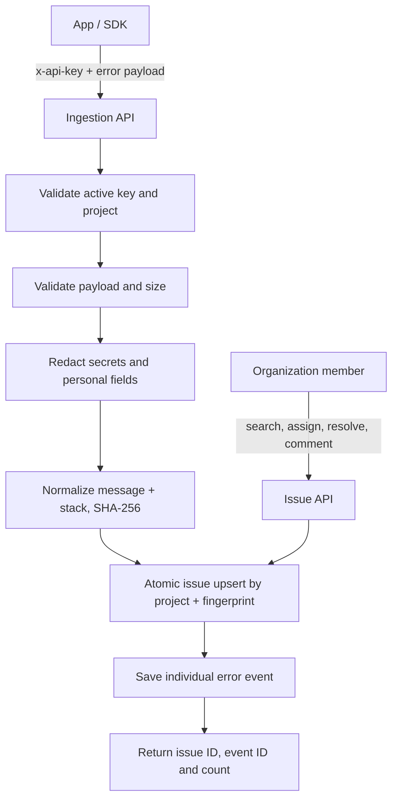
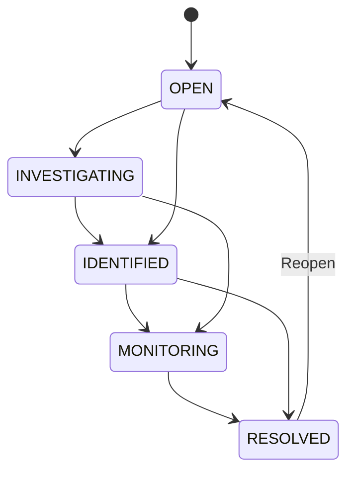
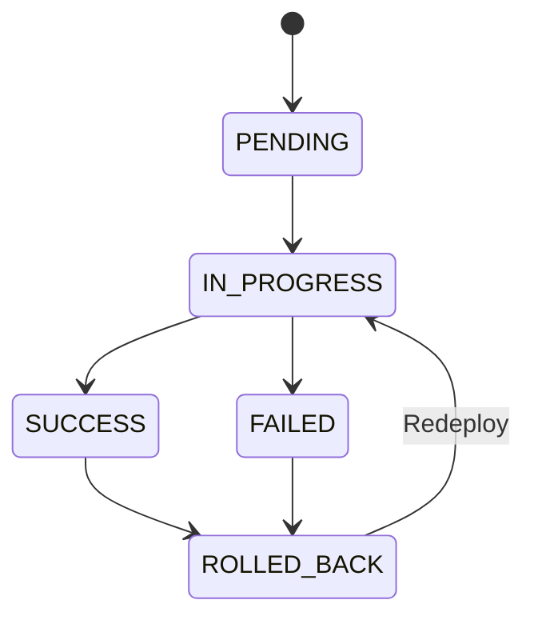
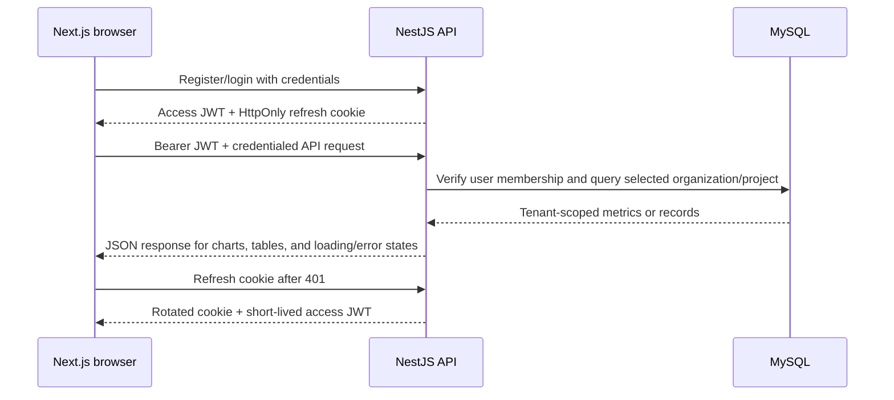

# FixFlow AI API

The API uses the `/api/v1` prefix. Authentication endpoints use JSON request
bodies, return JSON responses, and set an HttpOnly refresh-token cookie where
noted. Send access tokens as `Authorization: Bearer <accessToken>`.

## Authentication

### Register

`POST /api/v1/auth/register` returns `201 Created`.

```json
{
  "name": "Asha Developer",
  "email": "asha@example.test",
  "password": "a-long-password-at-least-12"
}
```

Password length is 12–72 characters and must not exceed 72 UTF-8 bytes. It
must include uppercase and lowercase letters, a number, and a special
character. Registration assigns the `developer` platform role; callers cannot
choose their role. Organization membership roles will be modeled separately
from platform roles.
Successful registration returns an access token and user profile and sets a
refresh cookie. Password hashes and refresh tokens are never returned.

### Login

`POST /api/v1/auth/login` returns `200 OK`.

```json
{
  "email": "asha@example.test",
  "password": "Strong-password-123!"
}
```

The response contains `accessToken`, `tokenType`, `expiresIn` (seconds), and a
safe `user` object. The rotating refresh token is only set in the
`fixflow_refresh` cookie.

### Refresh

`POST /api/v1/auth/refresh` requires the `fixflow_refresh` cookie and returns a
new access token while replacing the refresh cookie. The old refresh token is
revoked in the same database transaction. If an already-rotated token is
replayed, all active refresh tokens and access tokens belonging to that device
session family are revoked; other device sessions remain valid. The request
returns `401 Unauthorized`.

### Logout

`POST /api/v1/auth/logout` requires a valid access token and returns
`204 No Content`. It revokes every active refresh session and increments the
user's authentication version, invalidating outstanding access tokens as well.

### Current user

`GET /api/v1/auth/me` requires a valid access token.

```json
{
  "id": "uuid",
  "email": "asha@example.test",
  "name": "Asha Developer",
  "role": "developer"
}
```

### Role-protected example

`GET /api/v1/auth/admin` requires a valid access token and the persisted
`admin` or `super_admin` platform role. Developers and managers receive
`403 Forbidden`. User registration never grants these roles.

## Common responses

| Status | Meaning |
| --- | --- |
| `201` | Registration succeeded |
| `200` | Login, refresh, or profile request succeeded |
| `204` | Logout succeeded |
| `400` | DTO validation failed, including unknown fields |
| `401` | Missing/invalid/revoked/expired credentials |
| `403` | Authenticated user lacks the required role |
| `409` | Email is already registered |
| `429` | Authentication request rate limit exceeded |

Errors use the API's standard shape:

```json
{
  "success": false,
  "statusCode": 401,
  "message": "Invalid email or password",
  "timestamp": "2026-11-06T00:00:00.000Z",
  "path": "/auth/login"
}
```

DTO validation errors return a list of messages in `message`.

## Browser and cookie behavior

The frontend must send requests with credentials enabled. The API allows only
the configured `WEB_ORIGIN` and enables credentialed CORS. The refresh cookie
is `HttpOnly`, `SameSite=Lax`, scoped to `/api/v1/auth`, and `Secure` by default
in production. For local HTTP development, `COOKIE_SECURE=false`.

The API's in-memory throttle limits registration to 20 requests/minute, login
to 10 requests/minute, refresh to 10 requests/minute, and other auth routes to
100 requests/minute per client IP. This protects a single local instance; a
multi-instance production deployment should use a shared throttler storage
backend and edge-level rate limits.

## Database

Apply schema changes before starting the API:

```bash
cd fixflow-api
npm run migration:run
```

`users` stores bcrypt password hashes, roles, and an authentication version.
`refresh_sessions` stores only SHA-256 hashes of high-entropy refresh tokens,
expiration/revocation timestamps, a per-device session-family ID, and a
reference to the replacement session. Replaying a rotated token revokes only
that device family; other active device sessions remain valid. TypeORM schema
synchronization is disabled.

## Authentication versus authorization

- **Authentication** answers “Who is making this request?” `JwtAuthGuard`
  verifies the signed, short-lived bearer token and checks its user and active
  device family against MySQL.
- **Authorization** answers “Is this user allowed to do this?” `RolesGuard`
  checks the current database-backed platform role against `@Roles(...)`.

The centralized platform roles are `SUPER_ADMIN`, `ADMIN`, `MANAGER`, and
`DEVELOPER`. Future organization roles belong on organization memberships,
not on the global user role.

## Authentication sequence



### Curl examples

Register and save the refresh cookie:

```bash
curl -i -c cookies.txt -X POST http://localhost:3001/api/v1/auth/register \
  -H "Content-Type: application/json" \
  -H "Origin: http://localhost:3000" \
  -d '{"name":"Asha Developer","email":"asha@example.test","password":"Strong-password-123!"}'
```

Use the returned access token for a protected profile request:

```bash
curl http://localhost:3001/api/v1/auth/me \
  -H "Authorization: Bearer <accessToken>"
```

Rotate the refresh token. Keep the cookie jar so the replacement cookie is
saved, and use the new access token returned in the response:

```bash
curl -i -b cookies.txt -c cookies.txt -X POST \
  http://localhost:3001/api/v1/auth/refresh \
  -H "Origin: http://localhost:3000"
```

Log out all of the account's active sessions:

```bash
curl -i -b cookies.txt -X POST http://localhost:3001/api/v1/auth/logout \
  -H "Authorization: Bearer <accessToken>" \
  -H "Origin: http://localhost:3000"
```

### CSRF and browser cookies

The refresh cookie is `HttpOnly`, `SameSite=Lax`, path-scoped, and `Secure` in
production. Cookie-setting or cookie-consuming POST endpoints reject a supplied
`Origin` that does not exactly match `WEB_ORIGIN`; browser clients must send
their normal `Origin` header. Requests without an `Origin` remain available to
non-browser clients such as curl. CORS is not a CSRF defense by itself. If the
deployment becomes cross-site, use `SameSite=None; Secure` only with an explicit
CSRF token mechanism and strict origin checks; do not simply relax cookie
settings.

### Device concurrency and limits

Each successful registration or login creates a separate refresh family, so a
user can stay signed in on multiple devices. Rotation locks the user/session
rows in a transaction. If two requests try to rotate the same cookie
concurrently, only one can rotate it; the second is treated as reuse and
revokes that family. Other device families remain active. Logout currently
means “log out all devices”; family-specific logout can be added with a session
management endpoint later.

## Organizations and projects

Every route below requires `Authorization: Bearer <accessToken>`. An
organization member sees only organizations they belong to. Requests for
another tenant's organization or project return `404` to avoid confirming that
the resource exists. A member can hold a different organization role in each
organization.

### Organization routes

| Method and path | Access | Behavior |
| --- | --- | --- |
| `POST /api/v1/organizations` | Any authenticated user | Create organization; caller becomes `OWNER` |
| `GET /api/v1/organizations` | Any authenticated user | List only the caller's organizations |
| `GET /api/v1/organizations/:organizationId` | Organization member | Read organization |
| `PATCH /api/v1/organizations/:organizationId` | `OWNER`, `ADMIN` | Update name and/or slug |
| `GET /api/v1/organizations/:organizationId/members` | Organization member | List safe member profiles and roles |
| `POST /api/v1/organizations/:organizationId/invitations` | `OWNER`/`ADMIN`; `MANAGER` may invite `DEVELOPER`/`VIEWER` | Create mock invitation |
| `POST /api/v1/organizations/invitations/accept` | Authenticated invited email | Accept invitation |
| `POST /api/v1/organizations/invitations/reject` | Authenticated invited email | Reject invitation |
| `PATCH /api/v1/organizations/:organizationId/members/:memberUserId/role` | `OWNER`, `ADMIN` | Change membership role |
| `DELETE /api/v1/organizations/:organizationId/members/:memberUserId` | `OWNER`, `ADMIN` | Remove membership |

Invitation creation returns an `invitation` object and `mockDelivery` containing
the one-time `acceptToken`. This is a local mock email delivery channel, not a
real email integration; pass the token to the invited user out of band. Only
its SHA-256 hash is stored. The invitee must be signed in with the invited
email. Owners cannot be assigned or removed using invitation/member role
routes; an ownership-transfer workflow is not part of this phase.

### Organization roles

`OWNER` and `ADMIN` can update organization settings and manage members. Only
the owner can grant/manage admin membership. `MANAGER` can create/update/archive
projects and invite developers/viewers. `DEVELOPER` and `VIEWER` can read
projects; only owner/admin/manager can manage project API keys. Invitations
cannot grant `OWNER`. Platform roles and organization membership roles are
independent.

### Project routes

| Method and path | Access | Behavior |
| --- | --- | --- |
| `POST /api/v1/organizations/:organizationId/projects` | `OWNER`, `ADMIN`, `MANAGER` | Create a project |
| `GET /api/v1/organizations/:organizationId/projects` | Organization member | List active projects |
| `GET /api/v1/projects/:projectId` | Organization member | Get active project |
| `PATCH /api/v1/projects/:projectId` | `OWNER`, `ADMIN`, `MANAGER` | Update project |
| `DELETE /api/v1/projects/:projectId` | `OWNER`, `ADMIN`, `MANAGER` | Soft-archive project |

Project identifiers are generated by the API and unique. Project archive keeps
the row for history and disables API-key validation for that project.

### Project API keys

| Method and path | Access | Behavior |
| --- | --- | --- |
| `POST /api/v1/projects/:projectId/api-keys` | `OWNER`, `ADMIN`, `MANAGER` | Create key; returns plaintext exactly once |
| `GET /api/v1/projects/:projectId/api-keys` | Organization member | List safe metadata, including revoked keys |
| `POST /api/v1/projects/:projectId/api-keys/:keyId/rotate` | `OWNER`, `ADMIN`, `MANAGER` | Atomically revoke old key and issue replacement |
| `DELETE /api/v1/projects/:projectId/api-keys/:keyId` | `OWNER`, `ADMIN`, `MANAGER` | Revoke key |

Example create request:

```json
{ "name": "Production ingestion" }
```

The create/rotate response includes a `key` beginning with `ffk_live_`.
Copy it immediately; the API does not return it again. Only its SHA-256 hash,
short prefix, timestamps, and metadata are stored. Never put a key in source,
client-side bundles, issue reports, or logs. Future ingestion endpoints can use
the exported `ProjectApiKeyGuard` with the `x-api-key` header; the guard
validates active keys, refreshes `lastUsedAt` at most once per minute per API
process, and places the project/key IDs on the request. This coalesces writes
under frequent ingestion traffic; in a multi-instance deployment each process
may refresh the timestamp independently.

### Multi-tenant organization flow



In simple Hinglish: har org ka data `organization_id` se scope hota hai. API
pehle logged-in user ki membership database se check karti hai, phir role ke
hisab se action allow/deny hota hai. URL ka org/project ID akela permission
nahi deta—isi se IDOR/cross-tenant access rukta hai. Ek hi user Org A mein
`OWNER` aur Org B mein `VIEWER` ho sakta hai.

Create an organization:

```bash
curl -i -X POST http://localhost:3001/api/v1/organizations \
  -H "Authorization: Bearer <accessToken>" \
  -H "Content-Type: application/json" \
  -d '{"name":"Payments Team","slug":"payments-team"}'
```

Invite a user using the returned organization ID. In this mock workflow,
`mockDelivery.acceptToken` represents the email link payload and is shown only
once in the invitation creation response:

```bash
curl -i -X POST \
  http://localhost:3001/api/v1/organizations/<organizationId>/invitations \
  -H "Authorization: Bearer <ownerAccessToken>" \
  -H "Content-Type: application/json" \
  -d '{"email":"dev@example.test","role":"developer"}'
```

The invited user signs in with that email and accepts:

```bash
curl -i -X POST http://localhost:3001/api/v1/organizations/invitations/accept \
  -H "Authorization: Bearer <inviteeAccessToken>" \
  -H "Content-Type: application/json" \
  -d '{"token":"<one-time-mock-delivery-token>"}'
```

Create a project with an authorized organization membership:

```bash
curl -i -X POST \
  http://localhost:3001/api/v1/organizations/<organizationId>/projects \
  -H "Authorization: Bearer <managerAccessToken>" \
  -H "Content-Type: application/json" \
  -d '{"name":"Orders API","description":"Production order service"}'
```

The API key is shown once when created:

```bash
curl -i -X POST \
  http://localhost:3001/api/v1/projects/<projectId>/api-keys \
  -H "Authorization: Bearer <managerAccessToken>" \
  -H "Content-Type: application/json" \
  -d '{"name":"Production ingestion"}'
```

## Error ingestion

`POST /api/v1/ingest/errors` authenticates with the `x-api-key` header. The
project is derived from the validated key; callers cannot select a project in
the payload. Active keys for archived projects and revoked keys are rejected.
The endpoint accepts at most 120 requests per minute per IP on this API
instance, and JSON request bodies are limited to 64 KiB. The rate-limit store
is in memory; multi-instance deployments need shared throttler storage and
edge-level limits.

Example:

```bash
curl -i -X POST http://localhost:3001/api/v1/ingest/errors \
  -H "x-api-key: <project-api-key>" \
  -H "Content-Type: application/json" \
  -d '{
    "message": "Payment authorization failed for order 123456",
    "stackTrace": "Error: payment failed\n    at charge (src/payment.ts:42:8)",
    "severity": "error",
    "environment": "production",
    "release": "2026.11.12",
    "endpoint": "/api/payments",
    "timestamp": "2026-11-12T08:30:00.000Z",
    "metadata": {
      "service": "checkout",
      "region": "ap-south-1",
      "retryCount": 2
    }
  }'
```

`message` and `severity` are required. Stack trace, environment, release,
endpoint, timestamp and metadata are optional. Severity is `critical`, `error`,
`warning`, or `info`. The response contains the issue and event IDs, stable
fingerprint, current event count, and whether the issue was newly created.
Credentials in text fields are redacted; sensitive metadata keys (such as
password, token, API key, authorization, email and user ID) are omitted.
Endpoint query strings are discarded. Keep metadata limited to safe,
diagnostic values—request bodies and user-identifying values should not be
sent.

### Fingerprints and grouping

Fingerprinting uses the sanitized message and stack. Text is Unicode-normalized,
case-folded, and whitespace-normalized; UUIDs, hexadecimal addresses and long
numeric values are replaced with placeholders. Stack line/column numbers and
absolute deployment roots before `src`, `dist`, or `build` are normalized.
SHA-256 of that signature is unique per project. Environment, release,
endpoint, and severity are deliberately excluded, so one bug seen in staging
and production remains one issue.

Ingestion runs an atomic MySQL upsert on `(project_id, fingerprint)`. It
increments `event_count` and merges unique environments/endpoints/releases in
the same transaction that stores the individual event. First/last seen use
the earliest/latest event timestamps, even if delivery is out of order.
Severity shows the highest severity ever seen for that issue. Concurrent
duplicate reports therefore share an issue without losing event counts.

### Issue management

All issue routes require an access token and a membership in the issue's
organization. Cross-organization issue IDs return `404`. All organization
members can read issues; `VIEWER` members are read-only, while other member
roles may assign, change status, and comment.

| Method and path | Behavior |
| --- | --- |
| `GET /api/v1/issues` | Search and list issues with pagination |
| `GET /api/v1/issues/:issueId` | Issue details plus up to 50 latest events, comments, and activity entries |
| `PATCH /api/v1/issues/:issueId/assignment` | Assign to an organization member or set `assigneeUserId` to `null` |
| `PATCH /api/v1/issues/:issueId/status` | Set `open`, `resolved`, or `ignored`; `open` reopens a resolved issue |
| `POST /api/v1/issues/:issueId/comments` | Add a comment |

List query parameters: `search`, `status`, `severity`, `environment`,
`projectId`, `page`, `limit`, `sort`, and `order`. `limit` defaults to 25 and
is capped at 100. Sort fields are `lastSeenAt`, `firstSeenAt`, `eventCount`,
and `severity`; order is `asc` or `desc`.

Resolve and reopen:

```bash
curl -i -X PATCH http://localhost:3001/api/v1/issues/<issueId>/status \
  -H "Authorization: Bearer <accessToken>" \
  -H "Content-Type: application/json" \
  -d '{"status":"resolved"}'

curl -i -X PATCH http://localhost:3001/api/v1/issues/<issueId>/status \
  -H "Authorization: Bearer <accessToken>" \
  -H "Content-Type: application/json" \
  -d '{"status":"open"}'
```

Status changes, assignments and comments are written to `issue_activity_logs`
within the same transaction as the change. Individual occurrences remain in
`error_events`.

### Error flow (simple Hinglish)



Simple Hinglish: application SDK API key bhejta hai, aur server us key se
project identify karta hai—payload ka `projectId` trust nahi hota. Server
credentials redact karke message/stack ka stable fingerprint banata hai.
Same project ka same signature aaye to naya issue nahi banta; existing issue
ka counter atomically badhta hai, aur raw occurrence alag event ke roop mein
history mein store hoti hai.

### Status codes

| Status | Meaning |
| --- | --- |
| `400` | Invalid payload, unsupported fields, or validation failure |
| `401` | Missing, invalid, revoked, or archived-project API key |
| `404` | Issue/project is not available to the authenticated organization member |
| `403` | A read-only viewer attempts to modify an issue |
| `413` | Request body exceeds 64 KiB |
| `429` | Ingestion rate limit exceeded |

## Incident management

Incident routes require an access token and membership in the path's
organization. All member roles can read; `VIEWER` is read-only. Other
organization roles can create, update, assign, link issues, and archive.
Cross-organization IDs return `404`. Supplying `projectId` scopes an incident
to that project; without it, an incident may link issues from any project in
the same organization. A supplied owner and every linked issue must belong to
that organization (and, for project-scoped incidents, to the same project).

Severity is `SEV1` (Critical), `SEV2` (High), `SEV3` (Medium), or `SEV4` (Low).
Status is `OPEN`, `INVESTIGATING`, `IDENTIFIED`, `MONITORING`, or `RESOLVED`.
Changing status to `RESOLVED` sets `resolvedAt`; moving to another status
reopens the incident and clears it. Titles, descriptions, and resolution notes
are redacted before storage. Incident deletion is a soft archive so the
timeline and issue links remain available for audit/retention.

| Method and path | Behavior |
| --- | --- |
| `POST /api/v1/organizations/:organizationId/incidents` | Create incident; optional `projectId`, `severity`, and `ownerUserId` |
| `GET /api/v1/organizations/:organizationId/incidents` | Search/filter and paginate incidents |
| `GET /api/v1/organizations/:organizationId/incidents/:incidentId` | Details and linked issue summaries |
| `PATCH /api/v1/organizations/:organizationId/incidents/:incidentId` | Update title/description, severity, status, owner, or resolution notes |
| `DELETE /api/v1/organizations/:organizationId/incidents/:incidentId` | Soft-archive the incident |
| `GET /api/v1/organizations/:organizationId/incidents/:incidentId/timeline` | Paginated audit history |
| `POST /api/v1/organizations/:organizationId/incidents/:incidentId/issues` | Link `{ "issueId": "<uuid>" }`; repeated links are idempotent |
| `DELETE /api/v1/organizations/:organizationId/incidents/:incidentId/issues/:issueId` | Unlink an issue |

Incident list query parameters are `search`, `projectId`, `status`, `severity`,
`page`, `limit`, `sort` (`createdAt`, `updatedAt`, `severity`), and `order`
(`asc` or `desc`). Page size defaults to 25 and is capped at 100. Timeline
pagination uses `page` and `limit` (default 50, maximum 100). State changes,
severity changes, owner assignments, issue link/unlink, resolution-note edits,
and creation are written to `incident_timeline` in the same transaction as the
incident mutation. Timeline details contain identifiers and field names, not
the potentially sensitive note text.

Lifecycle:



Create and update examples:

```bash
curl -i -X POST http://localhost:3001/api/v1/organizations/<organizationId>/incidents \
  -H "Authorization: Bearer <accessToken>" \
  -H "Content-Type: application/json" \
  -d '{"projectId":"<projectId>","title":"Checkout outage","description":"Elevated checkout failures","severity":"SEV1","ownerUserId":"<memberUserId>"}'

curl -i -X PATCH http://localhost:3001/api/v1/organizations/<organizationId>/incidents/<incidentId> \
  -H "Authorization: Bearer <accessToken>" \
  -H "Content-Type: application/json" \
  -d '{"status":"RESOLVED","resolutionNotes":"Rollback restored checkout; monitor error rate."}'

curl -i -X POST http://localhost:3001/api/v1/organizations/<organizationId>/incidents/<incidentId>/issues \
  -H "Authorization: Bearer <accessToken>" \
  -H "Content-Type: application/json" \
  -d '{"issueId":"<issueId>"}'
```

## Deployment monitoring

Deployment routes are nested under a project and require an active
organization membership for that project. `VIEWER` can read but cannot mutate.
Environment is `PRODUCTION`, `STAGING`, or `DEVELOPMENT`; status is `PENDING`,
`IN_PROGRESS`, `SUCCESS`, `FAILED`, or `ROLLED_BACK`. Release is required;
`deployedAt` defaults to now and optional commit hashes must be 7–64 hex
characters. Metadata is passed through the existing secret/personal-data
redactor. Deleting a deployment soft-archives it.

| Method and path | Behavior |
| --- | --- |
| `POST /api/v1/projects/:projectId/deployments` | Create a deployment |
| `GET /api/v1/projects/:projectId/deployments` | Paginate and filter by environment/status/release |
| `GET /api/v1/projects/:projectId/deployments/:deploymentId` | Deployment details |
| `PATCH /api/v1/projects/:projectId/deployments/:deploymentId` | Update fields/status |
| `DELETE /api/v1/projects/:projectId/deployments/:deploymentId` | Soft-archive a deployment |
| `GET /api/v1/projects/:projectId/deployments/:deploymentId/impact?windowMinutes=60` | Compare errors before/after deployment |

Impact comparison uses equal configurable windows (1–10,080 minutes) before
and after `deployedAt`, and only events from the deployment's project and
environment. Error counts and severity distributions use each event's
`occurred_at` and severity. A post-deployment window that has not finished is
reported as `in_progress`; rates are normalized to observed minutes so partial
windows are not compared as if they were complete. `percentageChange` is based
on errors per minute, not raw totals. When the pre-deployment rate is zero and
the post rate is nonzero, the percentage is undefined and returned as `null`.

A fingerprint is classified as newly introduced only when its issue
`first_seen_at` falls in the observed post-deployment window; otherwise, an
after-window fingerprint is recurring. Findings are capped at 50 per class,
with counts provided separately. The `possibleRegression` flag means only
that the observed post-deployment rate is higher. It is a possible correlation
and does **not** establish that the deployment caused the errors. A lack of an
increase likewise does not prove there was no impact.

Lifecycle:



Create a deployment and inspect its impact:

```bash
curl -i -X POST http://localhost:3001/api/v1/projects/<projectId>/deployments \
  -H "Authorization: Bearer <accessToken>" \
  -H "Content-Type: application/json" \
  -d '{"environment":"PRODUCTION","release":"2026.11.12.1","status":"SUCCESS","commitHash":"abcdef1234567","metadata":{"pipeline":"github-actions"}}'

curl -i "http://localhost:3001/api/v1/projects/<projectId>/deployments/<deploymentId>/impact?windowMinutes=60" \
  -H "Authorization: Bearer <accessToken>"
```

### Simple Hinglish mental model

Incident ek organization ka coordinated response record hai: owner set hota
hai, related issues link hote hain, aur har important change timeline mein
transaction ke andar save hota hai. Deployment impact mein backend same
project/environment ke errors ko release ke pehle aur baad count karta hai.
Zyada rate ek signal hai—proof nahi—ki deployment responsible tha.

### Interview questions with answers

1. **Why keep `incident_issues` as a join table?**  
   One incident can group many issues and one issue can be relevant to multiple
   incidents. A composite primary key prevents duplicate links.
2. **Why save the timeline in the same transaction as a status update?**  
   It prevents state and audit history from disagreeing if either write fails.
3. **Why compare rates for a partial after-window?**  
   A shorter observation period naturally has fewer events; normalizing by
   observed minutes avoids a misleading raw-count comparison.
4. **Does a post-deploy spike prove the release caused it?**  
   No. The endpoint reports a possible temporal correlation, not causation;
   traffic changes, dependencies, and unrelated changes can also affect errors.

## Dashboard, analytics, alerts, and notifications

These Phase 8 routes require a bearer access token and an active membership in
the organization path. Supplying another organization's ID does not grant
access. Optional project filters are validated against that organization.

| Method and path | Behavior |
| --- | --- |
| `GET /api/v1/organizations/:organizationId/analytics/dashboard` | Live summary metrics, error trend/severity, affected endpoints, frequent issues, recent errors/incidents/deployments, resolution time and incident trend |
| `GET /api/v1/organizations/:organizationId/alert-rules` | List active organization alert rules |
| `POST /api/v1/organizations/:organizationId/alert-rules` | Create `CRITICAL_ERROR` or `ERROR_SPIKE` rule |
| `PATCH /api/v1/organizations/:organizationId/alert-rules/:ruleId` | Update enabled state, scope, threshold or cooldown |
| `DELETE /api/v1/organizations/:organizationId/alert-rules/:ruleId` | Soft-archive a rule |
| `GET /api/v1/organizations/:organizationId/notifications` | List only the caller's notifications |
| `GET /api/v1/organizations/:organizationId/notifications/unread-count` | Count unread notifications for caller |
| `PATCH /api/v1/organizations/:organizationId/notifications/:notificationId/read` | Mark caller's notification read |

Dashboard query parameters are `projectId`, `environment`, `from`, and `to`.
Dates must be ISO-8601; the default range is the last 24 hours and the maximum
range is 90 days. `environment` is `production`, `staging`, or `development`.
The response includes:

- `metrics`: error-event count, open/resolved/critical issue counts, open and
  critical incidents, and affected endpoints
- `errorActivity` and `errorDistribution`: chart-ready buckets and severity
  counts from individual events
- `topEndpoints`, `mostFrequentIssues`, `recentErrorEvents`,
  `recentIncidentActivity`, and `recentDeployments`
- `resolutionTime`: average minutes from first-seen to resolution for issues
  resolved in the selected range, plus the number of resolved issues
- `incidentTrend`: created and resolved counts grouped by hour or day

Example dashboard query:

```bash
curl -G http://localhost:3001/api/v1/organizations/<organizationId>/analytics/dashboard \
  -H "Authorization: Bearer <accessToken>" \
  --data-urlencode "projectId=<projectId>" \
  --data-urlencode "environment=production" \
  --data-urlencode "from=2026-11-12T00:00:00.000Z" \
  --data-urlencode "to=2026-11-13T00:00:00.000Z"
```

Create a critical-error rule (organization-wide if `projectId` is omitted):

```bash
curl -i -X POST \
  http://localhost:3001/api/v1/organizations/<organizationId>/alert-rules \
  -H "Authorization: Bearer <accessToken>" \
  -H "Content-Type: application/json" \
  -d '{"name":"Production critical errors","type":"CRITICAL_ERROR","projectId":"<projectId>","environment":"production","cooldownMinutes":15}'
```

Create an error-spike rule. Both limits are required; a rule triggers when the
count of accepted events in its rolling window reaches `thresholdCount`:

```bash
curl -i -X POST \
  http://localhost:3001/api/v1/organizations/<organizationId>/alert-rules \
  -H "Authorization: Bearer <accessToken>" \
  -H "Content-Type: application/json" \
  -d '{"name":"Checkout error spike","type":"ERROR_SPIKE","projectId":"<projectId>","thresholdCount":20,"windowMinutes":5,"cooldownMinutes":15}'
```

Rule creation and edits require `OWNER`, `ADMIN`, or `MANAGER`. Alert evaluation
runs in the error-ingestion transaction, applies project/environment scope and
a per-rule cooldown, and persists in-app notifications for organization
members. Email state is always `simulated`; this project does not send email.
Spike windows use the MySQL server clock and accepted-event creation timestamps
to avoid host/database timezone skew.

### Frontend request flow



Hinglish mein: browser pehle login karke short-lived access token memory mein
rakhta hai; refresh token JavaScript ko dikhai nahi deta, woh HttpOnly cookie
mein rehta hai. Har page organization/project filter ke saath API call karta
hai, lekin asli access check backend membership se hota hai. Expired access
token par browser refresh endpoint call karta hai aur naya token milne par
request ek baar retry hoti hai. Dashboard ke numbers demo nahi—selected
organization ke MySQL records se aate hain. Notification ka email abhi sirf
mock/simulated hai.

## Phase 9: AI incident intelligence

Local AI is opt-in. The application remains fully usable when the AI service,
embedding model, or Ollama is unavailable. The browser only calls NestJS; it
never receives the internal service token or talks directly to Python/Ollama.
Analysis runs only after a user explicitly requests it from an issue or
incident detail page.

### Public authenticated API

All endpoints below require `Authorization: Bearer <accessToken>` and a
current organization membership for the source record. A source from another
organization is reported as `404`. The caller cannot select a different
organization for analysis: NestJS resolves source tenancy from MySQL.

| Method and path | Behavior |
| --- | --- |
| `GET /api/v1/ai/health` | Report whether the optional AI service is configured and healthy |
| `POST /api/v1/ai/issues/:issueId/analyze` | Analyze the issue and retrieve related historical context |
| `GET /api/v1/ai/issues/:issueId/analysis/latest` | Get the latest saved successful analysis, or `analysis: null` |
| `GET /api/v1/ai/issues/:issueId/similar` | Find semantically similar current issues |
| `POST /api/v1/ai/incidents/:incidentId/analyze` | Summarize an incident using its timeline, linked issues and related context |
| `GET /api/v1/ai/incidents/:incidentId/summary` | Get the latest saved successful incident analysis |
| `POST /api/v1/ai/knowledge/search` | Search current sanitized knowledge for a member-authorized organization/project |

Analysis and similar-search endpoints accept the optional body:

```json
{
  "limit": 5,
  "similarityThreshold": 0.45
}
```

`limit` is bounded by server configuration; `similarityThreshold` must be
between 0 and 1. Knowledge search accepts `organizationId`, optional
`projectId`, `query`, optional `limit`, and optional
`similarityThreshold`. Search scope is validated against organization
membership and project ownership before querying the vector store.

A successful analysis is returned as `{ "data": { ...analysis } }` and stored
in `ai_investigations`; latest-result endpoints return
`{ "analysis": null }` when no successful analysis exists. The structured
result includes:

- `incidentSummary` and `probableRootCause` (explicitly a hypothesis)
- `confidence`, `confidenceLabel`, `confidenceRationale`, and
  `evidenceSufficiency`
- `evidence`, each referencing only a source ID authorized by NestJS
- `potentialImpact`, `debuggingSteps`, and `remediationSuggestions`
- `modelName`, source type/ID, and creation time

Example (adapt issue ID and access token):

```bash
curl -i -X POST http://localhost:3001/api/v1/ai/issues/<issueId>/analyze \
  -H "Authorization: Bearer <accessToken>" \
  -H "Content-Type: application/json" \
  -d '{"limit":5,"similarityThreshold":0.45}'

curl -i http://localhost:3001/api/v1/ai/issues/<issueId>/analysis/latest \
  -H "Authorization: Bearer <accessToken>"

curl -i -X POST http://localhost:3001/api/v1/ai/incidents/<incidentId>/analyze \
  -H "Authorization: Bearer <accessToken>" \
  -H "Content-Type: application/json" \
  -d '{"limit":5}'
```

### Request and retrieval flow

```mermaid
sequenceDiagram
  participant UI as Issue/incident detail UI
  participant API as NestJS AI gateway
  participant DB as MySQL
  participant AI as Private FastAPI service
  participant Chroma as Local Chroma
  participant Ollama as Local Ollama
  UI->>API: Explicit analyze request + access JWT
  API->>DB: Verify membership and load tenant-scoped issue/incident context
  API->>DB: Load current related issues, incidents and deployments
  API->>AI: Index sanitized scoped corpus and retrieve relevant chunks
  AI->>Chroma: Embedding search with org/project metadata filters
  Chroma-->>AI: Similar source IDs and snippets
  AI-->>API: Related context
  API->>DB: Revalidate source IDs against current tenant corpus
  API->>AI: Analyze sanitized context + allowlisted evidence IDs
  AI->>Ollama: Local constrained-JSON inference
  Ollama-->>AI: Structured candidate analysis
  AI-->>API: Validated schema; evidence restricted to allowed IDs
  API->>DB: Store successful result in ai_investigations
  API-->>UI: Hypotheses, evidence, uncertainty and suggestions
```

### Private Python service API

Python is not intended to be exposed publicly. Run it on loopback or inside
the private Compose network. Mutating, search, and analysis routes require a
constant-time-checked `X-Service-Token` header. The token must contain at
least 32 bytes and is configured only through local environment variables.

| Method and path | Behavior |
| --- | --- |
| `GET /health` | Local process/model availability probe |
| `POST /v1/knowledge/index` | Replace/index sanitized source chunks within an organization/project scope |
| `POST /v1/knowledge/search` | Tenant/project-filtered semantic search |
| `DELETE /v1/knowledge/documents/:source_type/:source_id` | Remove a source's chunks |
| `POST /v1/analyze` | Ollama JSON inference with allowlisted source evidence |

FastAPI rejects unexpected request fields, caps request size, bounds text and
result lengths, redacts secrets again before embedding/inference, and returns
structured safe errors. A `503` means local AI is not configured or the Ollama
model is unavailable; a `502` means the inference response did not satisfy the
expected schema; a timeout returns an explicit gateway timeout. No success
response is fabricated.

Every indexing operation replaces the current bounded working set for its
organization/project scope. Project-scoped retrieval also permits
organization-wide incidents, while excluding other projects. The corpus is
loaded from current database records (bounded to recent issue/incident/
deployment records for predictable local resource use); deleted or archived
records are therefore pruned from the refreshed scope, and every candidate is
revalidated against current database records before NestJS returns it. Chroma
is a rebuildable retrieval index, never the source of truth.

### Security, confidence and limitations

- Tenant access is enforced in NestJS before Python calls. Python applies
  organization/project metadata filters as defense in depth.
- Stack traces, error messages, incident descriptions/timelines, comments,
  deployments, and model-produced strings are sanitized. Retrieved IDs are
  revalidated against live MySQL records; AI evidence IDs are allowlisted by
  NestJS and again by Python.
- `ai_investigations` keeps only successful structured results and actor,
  tenant, source, model and timestamp metadata. Source stack traces are not
  copied into this table.
- AI output is an unverified hypothesis—not a diagnosis, guaranteed fix, or
  automated code change. Evidence and model-generated suggestions remain
  visibly separate in the UI.
- Ollama and sentence-transformer model downloads are local-machine setup
  steps. Python 3.12 is recommended (supported range 3.11–3.13); Python 3.14
  can run the test suite with its fake encoder, but real Sentence Transformer
  inference has not been validated on 3.14.
- LangChain/LangGraph are intentionally not added: this flow needs one
  bounded retrieval + structured inference sequence, and direct Chroma and
  Ollama APIs avoid extra orchestration dependencies. The seams are isolated
  so a future workflow can adopt those frameworks if multi-step agents become
  necessary.
- Real model quality, latency, throughput, and hardware requirements depend
  on the locally selected model and are not guaranteed by unit tests. Do not
  send confidential data to external model APIs; this implementation is
  designed for local Ollama only.

### Simple Hinglish mental model

Developer issue/incident page par **Analyze with AI** dabata hai. NestJS pehle
check karta hai ki user us organization ka member hai, phir MySQL se sanitized
context leta hai. Python/Chroma same org aur project ke purane records mein
similar cheezein dhoondhta hai. Ollama local machine par possible root cause
aur debugging steps likhta hai. Backend evidence IDs dobara verify karke
result save karta hai. Ye AI ka educated guess hai—proof ya guaranteed fix
nahi; developer ko logs/code dekh kar verify karna hota hai.

### Interview questions with answers

1. **Why keep AI behind NestJS instead of calling FastAPI from the browser?**  
   NestJS owns authentication and tenant authorization. Keeping Python private
   also prevents exposing the service token and lets the gateway validate
   source IDs and response shapes.
2. **Why use Chroma if MySQL already stores issues?**  
   MySQL remains authoritative for relationships and access checks. Chroma
   supports semantic similarity retrieval over sanitized text; it is
   disposable and rebuilt from current records.
3. **How do you prevent a similar result from another tenant leaking?**  
   The gateway authorizes source tenancy, Python filters Chroma metadata by
   organization/project, then NestJS revalidates every result against its
   current database corpus before returning it.
4. **Why are AI recommendations called hypotheses?**  
   Retrieval and language-model output are probabilistic; matching evidence
   can help triage but cannot prove causality or guarantee a code fix.
5. **Why not LangChain/LangGraph now?**  
   This feature currently needs a single retrieval and structured local
   inference step. Native clients reduce dependencies and failure paths;
   orchestration frameworks become useful if the workflow grows into multiple
   stateful tools or approval steps.

## Phase 10: deployment operations

Phase 10 keeps the existing synchronous API behavior and adds opt-in
infrastructure for production deployment. The API/web, database, Redis,
optional AI service, and monitoring stack are described in root Compose files
and [DEPLOYMENT.md](./DEPLOYMENT.md). No production server or registry is
configured by this repository.

### Background AI analysis

Redis/BullMQ is used for AI analysis jobs that can take longer or need retry.
Existing synchronous analysis endpoints remain available and unchanged. With
`QUEUE_ENABLED=true`, the API exposes:

| Method and path | Behavior |
| --- | --- |
| `POST /api/v1/ai/issues/:issueId/analysis-jobs` | Enqueue an authorized issue investigation; returns HTTP 202 |
| `POST /api/v1/ai/incidents/:incidentId/analysis-jobs` | Enqueue an authorized incident summary; returns HTTP 202 |
| `GET /api/v1/ai/analysis-jobs/:jobId` | Return the job state to the user who submitted it |

Submission accepts the same bounded options as the synchronous analysis
route. Example:

```bash
curl -i -X POST http://localhost:3001/api/v1/ai/issues/<issueId>/analysis-jobs \
  -H "Authorization: Bearer <accessToken>" \
  -H "Content-Type: application/json" \
  -d '{"limit":5,"similarityThreshold":0.45}'
```

The response contains a stable `jobId` and BullMQ status (for example
`waiting` or `active`). Poll that ID using the same access token:

```bash
curl -i http://localhost:3001/api/v1/ai/analysis-jobs/<jobId> \
  -H "Authorization: Bearer <accessToken>"
```

Job IDs are deterministic for the submitting user, source type/ID and options,
so repeated submissions of the same request are deduplicated while Redis
retains the job. Status access is actor-scoped; unknown and other-user IDs
return 404. Jobs retry up to three attempts with exponential backoff starting
at one second. Completed state is retained for up to one day and failed state
for up to seven days, subject to count limits. The worker uses a stable
investigation ID across retries, preventing a repeated attempt from saving
duplicate investigation rows. Redis failure returns an explicit service
unavailable response; job state is not persisted in MySQL.

Job payloads contain identifiers and validated options only. The worker
reloads current records through the existing tenant-authorized service before
calling FastAPI. Raw stack traces, prompts, passwords and API credentials are
not copied into Redis. `AI_WORKER_CONCURRENCY` accepts 1–16 and defaults to 2.
Readiness reports Redis as required only when queues are enabled. A queued
analysis still needs the optional AI service configured; if Ollama/FastAPI is
unavailable, the job is retried and eventually reports `failed`. The completed
analysis itself is read from the existing issue/incident result endpoints.

### Health, metrics and structured logs

| Endpoint | Access | Use |
| --- | --- | --- |
| `GET /api/v1/health` | Public liveness | Process is running |
| `GET /api/v1/health/ready` | Public readiness | MySQL and enabled Redis queue checks |
| `GET /api/v1/internal/metrics` | Bearer token | Prometheus metrics; returns 404 if `METRICS_TOKEN` is not configured |
| AI service `GET /metrics` | Bearer token | Optional FastAPI request counters and latency |

Configure a high-entropy `METRICS_TOKEN` or `METRICS_TOKEN_FILE` outside the
repository and send `Authorization: Bearer <metrics-token>`. Metrics include
HTTP request totals/latency grouped by method, route template and status, API
runtime metrics, and queue counts by state. The API does not include URL
queries, request bodies, user identifiers or tokens in metric labels.

The NestJS and Python services emit structured JSON logs. NestJS returns
`X-Request-ID` and accepts a bounded, safe incoming value or generates a UUID;
the browser/API gateway forwards it to FastAPI. Each request log records
timestamp, severity, correlation ID, method, route template, response status
and latency. Request payloads, query strings, cookies, passwords, bearer
tokens, project API keys and raw stack traces are not logged. Errors should be
correlated by request ID rather than by logging request contents.

### Deployment and operations

Production Compose uses MySQL 8.4 and Redis 7.4 with persistent volumes and
private networking. The optional FastAPI service uses a persistent Chroma
volume; Ollama stays external and no model is downloaded during container
startup. MySQL, Redis and FastAPI ports are not published in the production
configuration. Web/API and monitoring ports bind to loopback for a TLS
reverse proxy.

TypeORM synchronization remains disabled. Apply reviewed migrations using the
explicit `migrate` profile after taking a verified backup and before starting
the new API version. The backup/restore scripts require explicit operator
confirmation for restore and never delete database volumes. Do not run
`docker compose down -v` on data that must be preserved.

GitHub Actions runs backend build/lint/unit/E2E checks against MySQL and Redis,
frontend lint/build, Python tests, dependency audits, Compose config
validation, and production image builds. A push to `main` creates commit-tagged
image archives as Actions artifacts. It does not push to a registry or deploy;
no production credentials or host are configured.

See [DEPLOYMENT.md](./DEPLOYMENT.md) for Compose commands, secret-file setup,
Windows backup/restore, monitoring access, recovery checks, and the production
readiness checklist.
