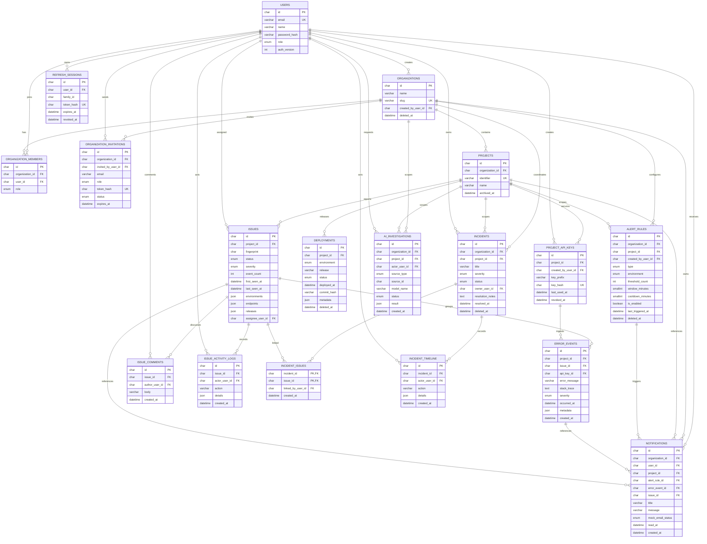

# FixFlow AI Database Schema

MySQL 8.4 is the local relational store. TypeORM synchronization is disabled;
schema changes are versioned migrations.

## Entity relationship diagram



## Tables and constraints

| Table | Purpose and key constraints |
| --- | --- |
| `users` | Unique email; bcrypt password hash excluded from ordinary entity selections; platform role and auth-version for token revocation |
| `refresh_sessions` | Unique SHA-256 token hash; indexed user and family IDs; self-reference to replacement session; user deletion cascades sessions |
| `organizations` | Unique slug; creator FK; soft-delete timestamp |
| `organization_members` | Membership joins users to organizations; unique `(organization_id, user_id)`; roles are scoped to this organization |
| `organization_invitations` | Hashed one-time invite token, intended email, invited role, status and expiry; organization deletion cascades invitations |
| `projects` | Organization FK; generated globally unique identifier; unique `(organization_id, name)`; archive timestamp |
| `project_api_keys` | Project/user FKs; unique SHA-256 key hash; key prefix and last-use/revocation timestamps, never plaintext |
| `issues` | Unique `(project_id, fingerprint)` groups duplicates; indexed project/status/severity/time and FULLTEXT title search; event counter and first/last timestamps; JSON sets of affected environments, endpoints and releases |
| `error_events` | One sanitized occurrence per accepted report; project, issue and API-key FKs; indexed issue/time and project/time; JSON metadata |
| `issue_comments` | Issue discussion with optional author FK and issue/time index |
| `issue_activity_logs` | Assignment, status and comment audit entries with optional actor FK and issue/time index |
| `incidents` | Organization-scoped incident; optional project scope; indexed status/severity/owner; soft archive preserves audit history |
| `incident_issues` | Composite primary key `(incident_id, issue_id)` prevents duplicate links; issue/incident FKs cascade; actor FK is nullable |
| `incident_timeline` | Incident event history with actor FK and incident/time index; state mutation and history insert share a transaction |
| `deployments` | Project/environment/release/status/time metadata; indexed by project/environment/time and project/status/time; soft archive |
| `alert_rules` | Organization/project-scoped critical-error or error-spike rule; indexed for enabled evaluation; stores cooldown and last-trigger time |
| `notifications` | Per-user organization notification with optional project/rule/event/issue references; indexed by user/created and user/read state; email status is only `simulated` |
| `ai_investigations` | Successful on-demand AI results; references organization/project/actor and a polymorphic issue/incident source; stores model name, sanitized structured output, status, and timestamp. It intentionally does not copy source stack traces. |

### Organization membership roles

The organization member role is one of `owner`, `admin`, `manager`, `developer`,
or `viewer`. A user may have a different role for every organization because
the role is stored on the membership row—not on the user record. This keeps
organization authorization separate from platform roles (`super_admin`,
`admin`, `manager`, `developer`).

### Tenant boundaries

Organization resources are queried only after checking a matching
`organization_members` row for the authenticated user. Project lookups resolve
the project's organization and verify membership before returning a record or
performing mutations. Unauthorized cross-tenant IDs return `404`, avoiding
resource-existence disclosure. Foreign keys and unique constraints provide
additional integrity but do not replace service-layer authorization.

### Invitation lifecycle

An invite token is generated with a cryptographic random source; only its
SHA-256 hash is stored. The mock-delivery response displays the raw token once
for local development. Acceptance/rejection locks the invitation row inside a
transaction, verifies the signed-in user's email matches, checks expiry and
pending status, then atomically changes status and (on acceptance) creates the
membership row.

### Project API keys

Project API keys use 256 bits of random entropy. The plaintext is shown only in
the successful create/rotate response. `project_api_keys.key_hash` stores the
SHA-256 digest; the prefix is for identifying a key in the UI, not
authentication. Validation hashes the presented credential, looks up an
active row, verifies the project is not archived, and refreshes `last_used_at`
at most once per minute per API process to avoid a write on every ingestion
request. Rotation revokes the previous key and inserts the new key in one
transaction.

### Error grouping and issue updates

The fingerprint is SHA-256 of normalized, redacted error message plus normalized
stack frames. UUIDs, hexadecimal values, long numbers, line/column locations and
deployment-specific absolute roots before `src`, `dist`, or `build` are
normalized. The fingerprint is unique within one project, not globally; the
same signature in separate projects remains separate.

Ingestion performs a MySQL `INSERT ... ON DUPLICATE KEY UPDATE` while storing
the event in the same transaction. The unique constraint serializes competing
reports for a new fingerprint, so the counter is incremented atomically and
dimension arrays are merged without duplicate values. `first_seen_at` and
`last_seen_at` take the min/max occurrence time; issue severity retains the
highest observed value. Raw event content is redacted before persistence;
sensitive metadata fields are omitted and endpoint query strings are dropped.

Issue comments and activity logs are organization-member protected in the API.
Status, assignment, comment and corresponding activity record are committed
together; individual error-event rows provide the occurrence history.

### Incidents and incident history

`incidents.organization_id` is the authorization tenant. `project_id` is
optional: when set, every linked issue must be in that project; without it,
linked issues may come from any project in the same organization. Owner
assignment is checked against organization membership. The service locks the
incident row and membership within a transaction before state changes or link
operations. The composite key on `incident_issues` is the final duplicate-link
guard. Incident deletes set `deleted_at` rather than removing history; related
issues and timeline records remain.

`incident_timeline` records creation, status/severity changes, owner changes,
issue link/unlink, resolution-note edits, general detail edits and archiving.
Timeline payloads store identifiers and changed-field names, not note bodies.
The history insert commits or rolls back with the corresponding mutation.

### Deployments and error comparison

`deployments` belongs to a project, so every read/write first checks the
authenticated user's organization membership for that project's organization.
Environment and lifecycle status use enums. Release metadata is sanitized
before persistence, and archived deployments remain in the database but are
hidden from normal list/detail/impact routes.

For a selected window of `N` minutes, the service compares
`[deployed_at - N, deployed_at)` with the observed part of
`[deployed_at, deployed_at + N)`. It filters `error_events` by project and by
case-insensitive deployment environment. Counts and severity distributions
are event-based. The comparison also separates fingerprints whose
`issues.first_seen_at` falls in the post-window from fingerprints seen earlier.
`percentageChange` is based on events per minute, allowing fair comparison
while the after-window is incomplete; a zero baseline with a positive after
rate has no mathematically defined percentage and returns `null`. Returned
fingerprint examples are capped at 50 per class, with total counts retained.

This is temporal evidence only. A higher post-deployment rate is labeled a
possible correlation; it does not prove that the release caused the errors.
Ingestion timestamps are supplied by the reporting application, so reliable
deployment comparisons depend on synchronized clocks and consistent
environment names (`production`, `staging`, or `development`).

### Alerts, notifications, and analytics

`alert_rules` belongs to an organization and can optionally target one project
and environment. `ERROR_SPIKE` requires a positive event threshold and a
positive rolling window; `CRITICAL_ERROR` does not use thresholds. During
ingestion, matching enabled rules are locked and evaluated in the same MySQL
transaction as the new event. Spike counts use `error_events.created_at` and
the MySQL server clock. A rule cooldown is updated atomically with its
notification writes, preventing concurrent ingestion requests from bypassing
the cooldown for the same rule.

Each alert creates separate `notifications` rows for organization members.
Reads and read-state changes are scoped to both the organization and the
authenticated user. `mock_email_status` is always `simulated`: it records that
the mock email path was considered, not that any email was delivered. The new
`IDX_error_events_project_created_environment` index supports project-scoped
rolling-window counts.

The analytics API uses indexed SQL aggregates rather than loading event rows
into application memory. Dashboard filters are validated against the caller's
organization, the default range is 24 hours, and ranges over 90 days are
rejected. Resolution duration uses each resolved issue's first-seen and
resolved timestamps; incident trends group incident creation/resolution by
hour or day.

### AI investigation retention and vectors

`ai_investigations` stores only successful, structured analysis results, the
source type/ID, organization/project/actor references, model name, status, and
creation time. The polymorphic `source_id` is checked by the service against
the corresponding tenant-scoped issue or incident query before reads and
analysis; it does not point to a single SQL table. Source stack traces are not
copied into this table.

Chroma persists sanitized text chunks and embeddings outside MySQL in the
Python service's configured local data directory (or Docker volume). Each
chunk includes organization and project metadata, and every query filters on
the authorized tenant scope. Before returning a match, NestJS revalidates the
source against current MySQL records and returns current sanitized content;
removed or stale vector entries therefore cannot be exposed as live results.
Chroma is a rebuildable retrieval index, not the system of record.

## Database migrations

The Phase 4 migration creates users and refresh sessions. The Phase 5 migration
adds organization/project tables and indexes; it also upgrades an earlier
Phase 4 platform-role/session schema if needed. The Phase 6 migrations add
issues, error events, comments, activity logs, and a title FULLTEXT index.
The Phase 7 migration adds incidents, incident issue links, incident timeline,
and deployments. The Phase 8 migration adds `alert_rules`, `notifications`, and
the error-event creation-time index. The Phase 9 migration adds
`ai_investigations`. Run migrations from `fixflow-api`:

Reverting Phase 5 drops its tenant tables but intentionally keeps compatible
auth-role/session column upgrades, so existing authentication data is not
downgraded or discarded.

```powershell
npm run migration:show
npm run migration:run
```

Always take a database backup before production migrations. Do not enable
`synchronize` in production.

Phase 10 adds no relational tables or migrations. BullMQ job payloads and
retry state live in Redis; MySQL remains authoritative for issues, incidents
and saved `ai_investigations`. Redis persistence uses its own Compose volume,
but queued jobs can be lost if Redis data is deliberately removed. Database
backup and restore commands, including a safe isolated-restore workflow, are
documented in [DEPLOYMENT.md](./DEPLOYMENT.md).

## Hinglish mental model

`users` identity table hai, par org permissions `organization_members` mein
store hoti hain. Isliye same developer ek org mein owner aur doosre mein viewer
ho sakta hai. `organization_id` har project par lagta hai; API membership ko
verify kiye bina project return nahi karti. Invitations aur API keys ke raw
secrets DB mein save nahi hote—sirf hashes store hote hain.
