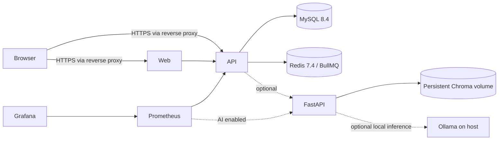

# FixFlow AI Deployment

This guide covers a small single-host production setup. It does not configure
an actual production server or deploy automatically. The Compose stack expects
Docker Engine with Compose v2 and uses MySQL 8.4, Redis 7.4, NestJS and Next.js.
FastAPI/Ollama and Prometheus/Grafana are optional.

## Architecture



In production, only the web/API and optional monitoring ports are published,
bound to `127.0.0.1` by default for a host-side TLS reverse proxy. MySQL,
Redis, FastAPI and Ollama must not be exposed publicly. The API and web have
health checks; readiness checks MySQL and Redis when queues are enabled.

## Prepare production configuration

From the repository root, copy the example and edit only non-secret settings:

```powershell
Copy-Item .env.production.example .env.production
notepad .env.production
New-Item -ItemType Directory -Force .\secrets | Out-Null
```

Set `WEB_ORIGIN` and `NEXT_PUBLIC_API_BASE_URL` to the actual HTTPS URLs that
the browser will use. Set the database name/user, image tags, and any host
port/reverse-proxy settings. `NEXT_PUBLIC_API_BASE_URL` is embedded into the
frontend build and is public configuration, not a credential.

Create random secret files without printing their values. Do not overwrite
existing files; keep them in the ignored `secrets\` directory and back them up
separately using protected storage:

```powershell
$secretNames = @(
  'mysql_root_password',
  'mysql_app_password',
  'redis_password',
  'access_token_secret',
  'metrics_token',
  'grafana_admin_password',
  'ai_service_token'
)
foreach ($name in $secretNames) {
  $path = Join-Path (Resolve-Path .\secrets) $name
  if (Test-Path -LiteralPath $path) {
    throw "Secret file already exists: $name"
  }
  node -e "process.stdout.write(require('node:crypto').randomBytes(48).toString('base64url'))" |
    Set-Content -LiteralPath $path -NoNewline -Encoding ascii
}
```

If AI or monitoring will not be enabled, their token/password files may remain
unused. Never paste secret values into Compose YAML, Dockerfiles, source,
PowerShell command arguments, CI logs or chat. Restrict access to the files
and to Docker administrator privileges; mounted Compose secrets are files
inside the containers, not a replacement for host access control.

## Build, migrate and start

The repository root is the Compose working directory. Use one stable project
name for all commands so Compose addresses the same volumes and services:

```powershell
$compose = @(
  'compose', '--project-name', 'fixflow-ai-prod',
  '--env-file', '.env.production',
  '--file', 'docker-compose.prod.yml'
)

docker @compose build api web
docker @compose up -d mysql redis
docker @compose ps
```

Wait for MySQL and Redis to report healthy. Check application connectivity
before migrating. The database is persistent in the `mysql_data` volume; do
not use `down -v`, delete volumes, or run a schema reset on an existing
deployment.

Take and verify a backup before applying migrations. Then run the explicit
migration profile and start the application:

```powershell
.\scripts\backup-mysql.ps1 -Docker
docker @compose --profile migrate run --rm migrate
docker @compose up -d api web
docker @compose ps
Invoke-WebRequest http://127.0.0.1:3001/api/v1/health/ready
Invoke-WebRequest http://127.0.0.1:3000/
```

The migration container runs the checked-in TypeORM migrations once and exits.
Application startup never runs migrations implicitly. Review migration output
and API readiness before connecting the reverse proxy. The commands do not
deploy to a remote host.

Use the reverse proxy to terminate TLS and route the public web/API domains to
their loopback ports. Configure the API's `WEB_ORIGIN` exactly to the browser
origin and preserve `X-Request-ID` when supplied (the application validates it
and creates one if invalid). Do not change `API_BIND_ADDRESS` or
`WEB_BIND_ADDRESS` to `0.0.0.0` unless a specific network boundary and
firewall policy require it.

### Optional AI

AI is not required for normal application operation. It is not enabled in the
base production Compose file. To add the private FastAPI service, configure
`AI_SERVICE_TOKEN_FILE`, `OLLAMA_BASE_URL`, `OLLAMA_MODEL`, and the embedding
provider/model in `.env.production`, then use the AI overlay:

```powershell
docker @compose --file docker-compose.ai.prod.yml config -q
docker @compose --file docker-compose.ai.prod.yml up -d ai-service
```

The overlay configures the API to call FastAPI over the private backend
network. Ollama remains an external host service and must be reachable from
the AI container; restrict its listener to trusted local traffic. The
container does not install, pull or start an Ollama model. Pull models
manually, after checking available RAM and disk. Chroma state is kept in the
`ai_chroma_data` volume. Synchronous AI routes continue to work if AI is
disabled, while AI operations report an explicit unavailable response.

### Optional monitoring

Create the metrics token and Grafana password files, then start the
Prometheus/Grafana overlay:

```powershell
docker @compose `
  --file docker-compose.monitoring.prod.yml `
  config -q
docker @compose `
  --file docker-compose.monitoring.prod.yml `
  up -d prometheus grafana
```

Prometheus and Grafana bind to loopback (`9090` and `3002` by default).
Grafana is provisioned with the FixFlow dashboard and Prometheus datasource.
Open Grafana only through a trusted host session or an authenticated TLS
proxy. Rotate the generated admin password and monitoring bearer token
according to the operator's policy. The AI scrape target is down until the
optional AI service is started; the API target remains protected by the same
bearer token.

NestJS exports request totals, latency histograms, default runtime metrics and
queue counts at `GET /api/v1/internal/metrics`. FastAPI exports request
metrics at `GET /metrics`. Both endpoints require `Authorization: Bearer
<metrics token>` and are disabled when no token is configured. The API's
`/api/v1/health` is liveness; `/api/v1/health/ready` checks MySQL and Redis.

## Background jobs

Redis/BullMQ is used for retryable AI analysis only; ingestion, CRUD and
existing synchronous AI endpoints remain synchronous. Job payloads contain
source IDs, requesting user ID and bounded options—not raw stack traces,
prompts, credentials or copied source data. The worker reloads current
tenant-scoped records. Stable job IDs prevent the same requester/source/options
from creating duplicate queued jobs. Jobs retry up to three attempts with
exponential backoff; successful state is retained for one day and failed
state for seven days, subject to the configured count caps. Worker concurrency
defaults to two and can be set from 1 to 16.

Redis persistence is enabled with AOF and its own volume. A queue is not the
source of truth: the SQL investigation record and source issue/incident remain
authoritative. Do not remove the Redis volume during routine restarts.

## CI/CD

`.github/workflows/ci.yml` runs backend build/lint/unit tests, MySQL
migrations/E2E tests, Redis queue retry tests, frontend lint/build, Python
tests and dependency audits. It validates Compose configuration and builds
production Docker images on pull requests and pushes to `main`.

The `main` workflow tags the local images with the commit SHA and uploads
image archives as Actions artifacts. It does not push to a registry, access a
production server, or deploy. No production credentials are needed for these
checks. A future deployment workflow should use GitHub Actions environment
protection, least-privilege secrets and an explicit approval gate; none is
configured here.

### Current npm audit limitation

The current npm audit database reports **GHSA-fc5q-39xc-vjpf /
CVE-2026-112366**, a high-severity ReDoS in `picomatch` through version
`4.0.7`. The installed lockfiles include `picomatch@4.0.7`; the official GitHub
advisory currently lists **no patched release**. The production API dependency
tree includes it transitively through `typeorm`/`tinyglobby`; frontend
development tooling also includes it. Do not force major downgrades or claim
this advisory is fixed. API source uses only constant, repository-defined
TypeORM glob patterns; untrusted request data is not used as a glob.

CI runs the full npm audit report and has a narrowly scoped exception for this
single advisory URL only, because upstream lists no fix. Any additional or
unclassified advisory fails the gate. Recheck the upstream advisory and
remove the exception as soon as a patched `picomatch` release and compatible
dependency ranges are available. This is a documented residual risk, not a
security remediation.

## Backup, restore and recovery

### Backup

For MySQL running on the Windows host, install the MySQL 8.4 client tools and
configure the ignored `fixflow-api/.env`; run:

```powershell
.\scripts\backup-mysql.ps1
```

For production Compose, the script executes `mysqldump` in the MySQL container
and reads the existing root secret without placing the password in arguments:

```powershell
.\scripts\backup-mysql.ps1 -Docker
```

Backups are timestamped under `backups\mysql` by default. The script checks
the dump header, publishes only a completed dump, calculates SHA-256, and
retains 14 days of matching backups in that dedicated directory. Override
`-RetentionDays` only to match an approved retention policy. The generated
SQL may contain application data; encrypt it at rest and in transit, restrict
access, and copy it to a separate protected system. This script does not
encrypt or upload backups.

For a scheduled daily job on Windows, use Task Scheduler with:

- Program: `powershell.exe`
- Arguments:
  `-NoProfile -ExecutionPolicy Bypass -File C:\path\to\fixflow-ai\scripts\backup-mysql.ps1 -Docker`
- Start in: `C:\path\to\fixflow-ai`

Use a dedicated Windows account with access to Docker and the secret files,
and configure Task Scheduler to alert on non-zero exit status. Avoid writing
passwords into the task definition.

### Restore and verify

Restore only after verifying the backup SHA-256 and selecting the intended
target database. Prefer a new empty recovery database. The script requires
`-ConfirmRestore` and the operator to type `RESTORE`; it never automatically
runs as part of deployment.

```powershell
Get-FileHash .\backups\mysql\fixflow-<database>-<timestamp>.sql -Algorithm SHA256
.\scripts\restore-mysql.ps1 `
  -BackupFile .\backups\mysql\fixflow-<database>-<timestamp>.sql `
  -Database fixflow_recovery `
  -ConfirmRestore
```

For production, add `-Docker` after the target database has been deliberately
created. The import can replace same-named tables in that target; never point
it at a live database without a separately verified pre-restore backup and
approved recovery plan. Confirm restored table counts and apply/review
migrations as appropriate. Restore to an isolated environment periodically:
a successful dump and hash do not prove recoverability.

### Migration and rollback policy

1. Review the migration diff and take a verified backup.
2. Run `npm run migration:show` against a staging copy first.
3. Use the production migration profile during a maintenance window.
4. Verify readiness and key workflows.
5. If rollback is needed, prefer a forward corrective migration or restore to
   an isolated instance; do not casually run `migration:revert` against
   production because a down migration may discard data.

## Security and operations checklist

- [ ] Replace example public URLs and secret-file values; keep `.env.production`
      and `secrets\` out of source control.
- [ ] Use unique, high-entropy MySQL, Redis, JWT, metrics, Grafana and optional
      AI service credentials.
- [ ] Protect the Docker host; membership in the Docker group/administrators is
      effectively privileged access.
- [ ] Keep MySQL, Redis, FastAPI and Ollama off public interfaces.
- [ ] Terminate TLS at a maintained reverse proxy and set `WEB_ORIGIN` to the
      real frontend origin.
- [ ] Configure host firewall rules, patch base images/dependencies, and
      rotate secrets using an approved procedure.
- [ ] Monitor health, error rates, p95 latency, failed/delayed queue jobs,
      disk space and backup task exit status.
- [ ] Test restore to a separate database and document recovery time/objectives.
- [ ] Run `docker compose config -q` before changes; never use `down -v` to
      troubleshoot a live database.
- [ ] Do not deploy until the target host, TLS, backups, access control,
      migrations and recovery process are explicitly configured and approved.

## Troubleshooting

- **Compose cannot connect to Docker:** start Docker Desktop/Engine and confirm
  `docker info` succeeds. Configuration validation does not require the daemon,
  but image builds and runtime tests do.
- **Database/Redis unhealthy:** inspect `docker compose ... ps` and
  `docker compose ... logs mysql redis`; verify mounted secret file paths and
  permissions. Do not delete the data volumes to fix startup.
- **API readiness fails:** inspect API logs by correlation ID and check MySQL
  connectivity, migration state, and Redis readiness when queues are enabled.
- **AI unavailable:** check the optional overlay, private `AI_SERVICE_URL`,
  matching service token files, Ollama reachability and manually installed
  model names. AI is optional and should not block core screens.
- **Metrics unauthorized:** confirm the Prometheus bearer token file is the
  same secret mounted into the API/Python service, and send it as a bearer
  header when testing.
- **Frontend calls wrong API:** rebuild the web image with the public
  `NEXT_PUBLIC_API_BASE_URL`; `WEB_ORIGIN` must exactly match the browser
  origin for cookie-based authentication.
